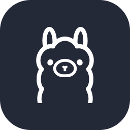

<h1 align="center">Diego Esparza</h1>

  <b>Full-stack developer · Databases & AI integration</b> 
  I build software that runs on your own machine: a local-first AI assistant over my notes, Linux setup tooling, and the databases behind team apps.

  
  
  

---

## What I build

### ARDANG — local-first AI assistant over my notes · *solo project*
A personal assistant that answers questions from my Obsidian vault using a language model running on my own PC — no cloud, and every answer shows which notes it came from.
- **What it does today:** searches the vault, selects and reads only the relevant notes within a size budget, asks a local Ollama model, and checks that every citation points to a note that was actually sent. CLI plus a PySide6 desktop window.
- **Design rules:** read-only by default; the model gets no tools and never touches the vault; writing a note only happens on an explicit user command.
- **My role:** everything — architecture, implementation, tests and documentation.
- **Stack:** Python (standard library core) · Ollama · PySide6 · Linux
- **→** [Project overview](https://github.com/ARIOT117/ARDANG-showcase)

### Mi Linux — personalized Linux post-install · *team project, front end*
A web platform that asks about your profile, hardware and workflow, then generates a post-install script you can review and run.
- **My role:** front end.
  - Built the questionnaire interface with HTML and CSS, where users describe their profile and hardware.
  - Rewrote the scroll and animation logic from JavaScript to pure CSS, fixing the mockup preview and its accessibility.
- **Stack:** HTML · CSS · JavaScript
- **→** [milinux.app](https://milinux.app) · [Repo](https://github.com/christianestrada1102/Mi-Linux) · built with [@christianestrada1102](https://github.com/christianestrada1102)

### Zumek — budget-first weekly meal planner · *team project, database & UI design*
A cross-platform app (web, Android, iOS) that builds a weekly meal plan starting from the money you have, real product package sizes and what is already in your pantry.
- **My role:** database design and configuration, and UI designs for the front end.
- **Stack:** TypeScript · React Native (Expo) · PostgreSQL · Supabase
- **→** [Repo](https://github.com/Gangbangers-Evolution/Zumek)

Also: <a href="https://catstore-puce.vercel.app">CATSTORE</a> — static storefront deployed on Vercel.

---

## Tech stack
Each row links to a public project that uses it.

| Area | Technologies | Evidence |
| --- | --- | --- |
| Languages |  | [ARDANG overview](https://github.com/ARIOT117/ARDANG-showcase) · [Zumek](https://github.com/Gangbangers-Evolution/Zumek) · [CATSTORE](https://github.com/ARIOT117/CATSTORE) · [Mi Linux](https://github.com/christianestrada1102/Mi-Linux) |
| Mobile |  React Native · Expo | [Zumek](https://github.com/Gangbangers-Evolution/Zumek) |
| Data |  | [Zumek](https://github.com/Gangbangers-Evolution/Zumek) |
| AI |  Ollama (local LLMs) | [ARDANG overview](https://github.com/ARIOT117/ARDANG-showcase) |
| Tools |  | [CATSTORE](https://catstore-puce.vercel.app) |

<!-- Cuando publiques javafx-jdbc-crud, sql-database-design y expense-tracker-firebase,
     agrega una fila: | Also | java, mysql, sqlite, firebase | enlaces | -->

---

## Currently
- Building ARDANG one phase at a time.
- Studying for a TSU in Multiplatform Software Development at Universidad Tecnológica de Chihuahua (UTCH).

## Open to
- Software development internships (full-stack, backend or data) — remote or in Chihuahua, Mexico.
- Working in English and Spanish.

## Contact

  
  
  <!-- Portafolio: descomenta cuando exista
  
  -->

---

<b>Versión en español</b>

Soy Diego Esparza, desarrollador full-stack enfocado en bases de datos e integración de IA, estudiante de TSU en Desarrollo de Software Multiplataforma en la UTCH (Chihuahua, México).

- **ARDANG:** asistente de IA local-first que responde desde mis notas de Obsidian con un modelo local (Python, Ollama).
- **Mi Linux:** plataforma que genera un script post-instalación de Linux; hice el front end.
- **Zumek:** planificador de comidas basado en presupuesto; hice el diseño de la base de datos y de la interfaz.
- **Busco:** prácticas full-stack, backend o de datos, remoto o en Chihuahua.

Contacto: diegoisaiuwu@gmail.com · [LinkedIn](https://www.linkedin.com/in/diego-isai-esparza-barron-56a38a43b/)

